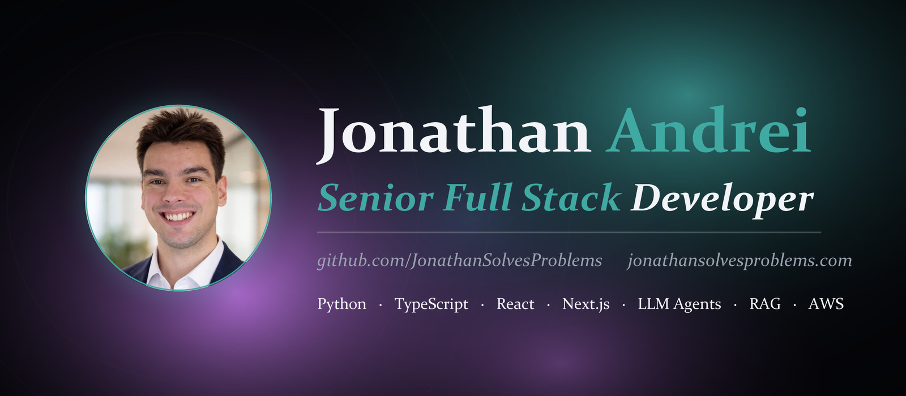
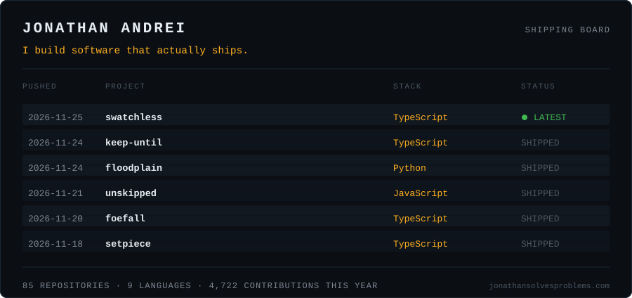

I build software that actually ships. Most of what is below started as a deadline and
ended as something that runs, against real data, in front of real users.

I work mostly in TypeScript and Python, lately on AI agents and developer tooling, and I
care more about whether a thing survives contact with real input than about how clean it
looks in a diagram.

I take on project work: AI agents, RAG pipelines, developer tooling, and integrations.
Details and selected work at [**jonathansolvesproblems.com**](https://jonathansolvesproblems.com).

<picture>
  <source media="(prefers-color-scheme: dark)" srcset="assets/board-dark.svg">
  <source media="(prefers-color-scheme: light)" srcset="assets/board-light.svg">
  
</picture>

<!-- SHIPPING-LOG:START -->
| Project | What it is | Stack |
| --- | --- | --- |
| **[keep-until](https://github.com/JonathanSolvesProblems/keep-until)** | Food bank sort-table app. Gemini Nano checks each photo on the laptop, the cloud reads the date… | TypeScript |
| **[foefall](https://github.com/JonathanSolvesProblems/foefall)** | Every monster shows where it will strike. Make them strike each other. A daily tactics puzzle f… | TypeScript |
| **[unskipped](https://github.com/JonathanSolvesProblems/unskipped)** | Your beta reader's face and pulse leave page flags in your manuscript. Presage SmartSpectra on… | JavaScript |
| **[floodplain](https://github.com/JonathanSolvesProblems/floodplain)** | Runs the test suites of a package's dependents before and after a release, in forked Nebius San… | Python |
| **[setpiece](https://github.com/JonathanSolvesProblems/setpiece)** | Seated mixed reality previs for VFX shots: block the shot on your table with your hands and lea… | TypeScript |
| **[call-it](https://github.com/JonathanSolvesProblems/call-it)** | Watches your game through OBS and runs prediction bets in your Twitch chat. Built in OpenAI Cod… | TypeScript |
<!-- SHIPPING-LOG:END -->

<details>
<summary>How this page keeps itself current</summary>

<br>

The board is not a third-party widget. It is an SVG this repo generates from my own
push history, so it reflects what I actually touched last rather than a static image
I updated once and forgot.

```
scripts/build_profile.py     queries the GitHub API, renders both themes, rewrites the table
scripts/build_banner.py      renders the banner from assets/portrait.png
assets/board-*.svg           dark and light boards, swapped by prefers-color-scheme
.github/workflows/           re-runs the generator every Monday and commits any change
```

Run `python scripts/build_profile.py` to refresh it by hand.

</details>
